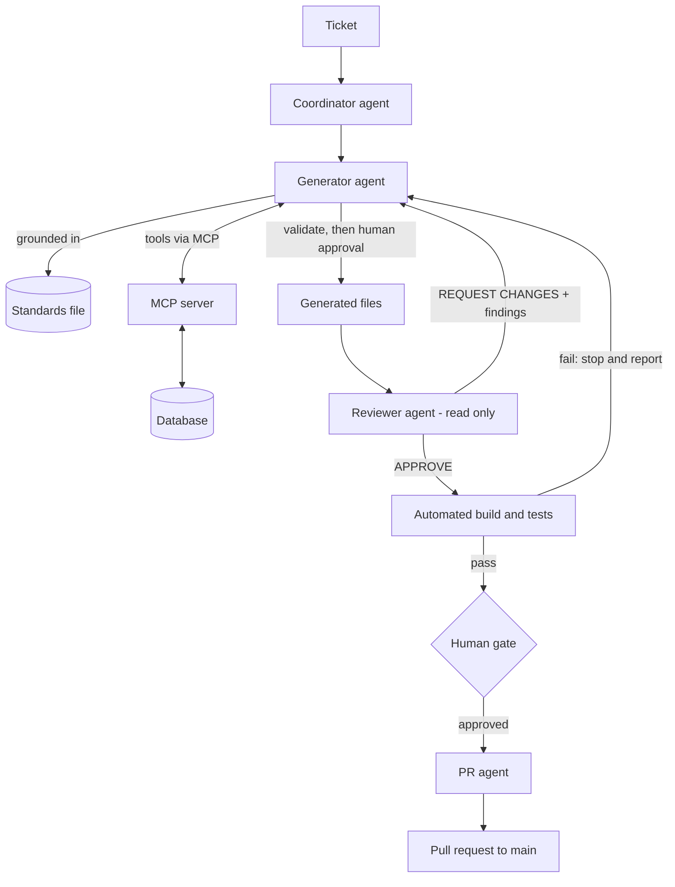

# Agentic AI for Project Workflow Automation

A multi-agent system that automates a full engineering workflow, **from ticket to reviewed, tested pull request**, with AI agents doing the work and humans approving at defined checkpoints.

> **Use case implemented here:** generating Data Vault 2.0 models with dbt on Snowflake. The use case is only a vehicle. The agent architecture, the guardrails and the automation pattern are reusable for any ticket-driven workflow (see [Reusing this for other workflows](#9-reusing-this-for-other-workflows)).


## 1. What this project is

Most engineering work follows a repeatable lifecycle:

```
Ticket → Understand context → Build → Check against standards → Test → Review → Raise PR
```

Each step is usually manual, and each hand-off is a chance for delay or inconsistency. This project turns that lifecycle into an **automated pipeline run by cooperating AI agents**. Each agent has one job, a limited set of tools, and clear rules for when to proceed, retry, or stop and ask a human.

The result is a workflow where a person supplies the **intent** (a ticket) and the **decisions** (approvals), and the agents handle the **execution**.

---

## 2. Why agentic AI, and not just a chatbot

A single prompt to a chat assistant can draft code. It cannot run a controlled process. This project uses agents because the workflow needs things a chat reply doesn't provide:

| Need | Chat assistant | This agentic setup |
|---|---|---|
| Take actions (query a database, write files, run builds, open PRs) | Suggests commands for a human to run | Agents call tools directly and check the results |
| Follow a multi-step process in order | Depends on the prompt and the user | A coordinator enforces the sequence |
| Check its own work | Rarely, and not independently | A separate reviewer agent plus a deterministic validator |
| Recover from failures | User pastes errors back manually | Review findings and build errors loop back automatically |
| Respect organisational standards | Relies on what the model "remembers" | Reads a written standard on every run |
| Stay safe | No built-in limits | Per-agent permissions, approval gates, stop-on-error rules |

In short, agentic AI moves AI from *"helps me write"* to *"runs the process, under supervision."*

---

## 3. Agentic patterns applied

| Pattern | How it appears here |
|---|---|
| **Orchestrator-worker** | `Data_Vault_Pipeline_Coordinator` dispatches the generator, reviewer and PR agents in a fixed order and routes verdicts between them. |
| **Specialised agents / separation of duties** | The agent that builds code is never the one that approves it. The reviewer is read-only and the PR agent only does git operations. |
| **Generator ↔ reviewer feedback loop** | A `REQUEST CHANGES` verdict is sent back to the generator with the exact findings. Fixes are applied and re-checked, not restarted from scratch. |
| **Tool use through MCP** | A local Model Context Protocol server exposes Snowflake SQL access, a validation tool and a git/PR tool to the agents. |
| **Standards as context (grounding)** | Agents are told to work exclusively from a written standards file, so output follows the team's rules and not the model's general guesses. |
| **Deterministic checks alongside LLM judgement** | A rule-based validator runs before anything is shown to a human, catching mechanical errors cheaply and reliably. |
| **Live-context retrieval before acting** | The generator must fetch the real table schema from the database before producing any code. It does not assume the schema. |
| **Human-in-the-loop gates** | Two explicit approvals: before files are written, and before the PR is created. |
| **Bounded autonomy** | Agents have least-privilege tools, explicit "never do" rules, and stop on the first failure instead of improvising. |

---

## 4. Architecture



### Agents

| Agent | Responsibility | Tools | Can modify files? |
|---|---|---|---|
| `Data_Vault_Pipeline_Coordinator` | Orchestrates the sequence, parses verdicts, triggers the human gate | `runSubagent` | No |
| `dv-model-generator` | Reads the ticket and standard, fetches live schema, builds and validates the deliverables | `sql_exec_tool`, `validate_model_tool`, `editFiles`, `runCommands` | Yes, only after explicit approval |
| `dv-code-reviewer` | Audits output against the standard and returns a verdict with line-level findings | `sql_exec_tool` | **No** (read-only by design) |
| `dv-pr-generator` | Stages the approved files, commits, pushes and opens the PR | `runCommands` | Git operations only |

### Tool layer (MCP server: `cortex_agent.py`)

A lightweight Python MCP server registered in `.vscode/mcp.json` as `snowflake-mcp`. It gives agents controlled access to the outside world:

| Tool | Purpose |
|---|---|
| `sql_exec_tool` | Run SQL against Snowflake (used for schema discovery and reference-data checks). |
| `validate_model_tool` | A rule-based validator that returns `{"pass": bool, "violations": [...]}` with no LLM involved. |
| `execute_git_pr` | Create a branch, commit, push and open a PR via the GitHub CLI. |

Agent behaviour lives in plain Markdown files in `.github/agents/`, so changing how an agent works means editing a text file. No code changes are needed.

---

## 5. How the workflow runs

1. **Dispatch.** The coordinator hands the ticket to the generator, instructing it to work only from the standards file and not to dig through git history (focus and speed rule).
2. **Pre-flight checks.** The generator confirms prerequisites (the source system is registered in the control table) and fetches the live schema of the source table. If either is missing, it **stops and tells the user**.
3. **Safe workspace.** It syncs `main` and creates a ticket-named branch (`<TICKET_ID>_DEV`).
4. **Build.** It generates the deliverables strictly from the standard's templates.
5. **Self-check.** The deterministic validator runs on every file. Failures are fixed and re-validated before a human sees anything.
6. **Human approval #1.** The generator shows the output, the validation results and a mapping of ticket requirements to files, then asks for a yes or no. Nothing is written without it.
7. **Independent review.** The reviewer agent audits the files and returns `APPROVE` or `REQUEST CHANGES`. On `REQUEST CHANGES`, the findings flow back to the generator and the loop repeats.
8. **Automated verification.** On `APPROVE`, the pipeline runs `dbt snapshot` and `dbt build` for the generated models. A failed build halts the run and surfaces the logs.
9. **Human approval #2.** The coordinator presents the approved files for sign-off.
10. **PR creation.** The PR agent shows the full plan (branch, exact files, commit message, PR body), asks once more, and on approval runs the git and `gh` commands. It returns the real PR URL.

---

## 6. The use case: Data Vault model generation

The workflow above is applied to **generating Data Vault 2.0 models in dbt on Snowflake**. It is a good fit for automation because the work is highly repetitive, follows strict rules, and mistakes are costly.

**Input:** a ticket naming the source table, business key, hash-key formula and the descriptive columns for a Satellite.

**Output:** a staging view, a Hub (or Link), and optionally a Satellite with its tests, all validated, reviewed, built and raised as a PR.

**What the standard (`DV_STANDARD.MD`) encodes for the agents:**

- Naming and schema conventions per layer (staging, raw vault, marts)
- Hashing happens once, in staging, and downstream models only select it
- A fixed multi-layer staging structure and a fixed 5-stage Hub/Link structure
- Ghost (sentinel) records, deduplication rules and incremental-loading patterns
- Source-system metadata (`REC_SRC`, `BKCC`) is looked up from a governed reference table, never hardcoded
- Satellite rules and the matching `.yml` constraint tests

**dbt project (`dv_gen_project`)** routes each layer to its schema and materialization (staging as views in `STAGING`; Hubs, Links and Satellites as incremental models in `RAW_VAULT`; marts as views in `INFO_MART`). A working example is included: `stg_sap_ecc_branches`, `hub_branch` and `sat_branch_details` with its tests.

Everything Data Vault specific lives in the standards file, the validator rules and the dbt project. The agent structure around it is independent of the use case.

---

## 7. Guardrails: keeping autonomy safe

Automation is only useful if it can be trusted. These controls are built into the agent definitions and the tool layer:

| Guardrail | Mechanism |
|---|---|
| No changes without consent | The generator may not write files before an explicit user approval. |
| Independent review | The reviewer has no write tools and cannot alter what it is reviewing. |
| Two human checkpoints | Approval before files are written and before the PR is created. |
| Grounded in reality | Live schema fetch is mandatory, and missing tables or source systems stop the run. |
| No invented data | Agents may read the governed reference table but must never insert or edit rows in it. |
| Deterministic validation first | `validate_model_tool` must pass before output is shown to a human. |
| Fail-stop behaviour | Any failed command or build halts the pipeline and reports the error. Git/`gh` failures are not retried automatically. |
| Safe git practice | No pushes to `main`, and the PR agent stages only specific approved files (no `git add -A`). |
| Review required for PRs | The PR agent refuses to run without an explicit `APPROVE` verdict. |
| Secrets stay local | `.env` is git-ignored, as are build artifacts and logs. |
| Speed and scope limits | Agents are told not to run git-history searches, not to chunk-read files, and to scope schema queries to the named tables. |

---

## 8. Effects on our projects

**Faster delivery.** The steps between "ticket accepted" and "PR opened" run as a single guided session. Context gathering, building, checking and PR packaging no longer wait on manual hand-offs.

**Less repetitive toil.** Engineers stop spending time on boilerplate and on style or structure checks, and can focus on business logic, design decisions and edge cases.

**Consistent quality at scale.** Because every run reads the same standards and passes the same checks, output looks the same regardless of who raised the ticket or how many tickets are in flight.

**Defects caught earlier.** Problems are intercepted in layers: the deterministic validator, then the reviewer agent, then the automated build and tests, and finally the human reviewer. Fewer issues reach the PR, and fewer still reach production.

**Review time goes to what matters.** Human reviewers receive a PR that has already passed mechanical checks and a build, so their attention goes to intent and correctness.

**Humans stay in control.** AI executes and people decide. Approval gates, a read-only reviewer and stop-on-error behaviour mean automation does not come at the cost of oversight.

**Built-in traceability.** Ticket-named branches, a standard PR template and a recorded review verdict give each change a clear audit trail from request to merge.

**Standards become executable.** Rules that used to live in wikis and people's heads are now enforced on every run. Changing the standard changes how all agents behave.

**Easier onboarding and less key-person risk.** New team members get compliant output from day one, and process knowledge is captured in the agent files and standards instead of one or two experts.

**Scales without more headcount.** More tickets can be processed in parallel without a matching increase in manual effort.

**A reusable automation foundation.** The same coordinator, generator, reviewer and PR pattern can be applied to other workflows (next section).

---

## 9. Reusing this for other workflows

To apply the pattern to another ticket-driven process (for example API endpoint scaffolding, test generation, infrastructure-as-code changes, documentation updates, or report builds), keep the structure and swap the domain content:

| Keep (generic) | Replace (domain-specific) |
|---|---|
| Coordinator, generator, reviewer and PR agent roles | The standards file (your team's rules and templates) |
| Generate → validate → approve → review → build → PR sequence | The validator rules in `validate_model` |
| Human approval gates and fail-stop rules | The reviewer's checklist |
| MCP tool layer and git/PR automation | The pre-flight checks and build and test commands |
| Branch naming and PR template | The tool integrations (a different database, API or service) |

---

## 10. Repository structure

```
.
├── .github/
│   └── agents/
│       ├── Data_Vault_Pipeline_Coordinator.agent.md   # Orchestrator agent
│       ├── dv-model-generator.agent.md                # Builder agent
│       ├── dv-code-reviewer.agent.md                  # Read-only reviewer agent
│       ├── dv-pr-generator.agent.md                   # Git / PR automation agent
│       └── DV_STANDARD.MD                             # Standards and templates the agents are grounded in
├── .vscode/
│   └── mcp.json                                       # Registers the MCP server ("snowflake-mcp")
├── cortex_agent.py                                    # MCP server: SQL, validator and git/PR tools
├── dv_gen_project/                                    # dbt project holding the generated models (use case)
│   ├── dbt_project.yml
│   ├── macros/generate_schema_name.sql
│   └── models/
│       ├── staging/
│       └── raw_vault/{hub,link,satellite}/
├── .env                                               # Local credentials (git-ignored)
└── .gitignore
```

---

## 11. Setup

**Prerequisites**

- VS Code with GitHub Copilot (agent mode / custom agents)
- [`uv`](https://docs.astral.sh/uv/) to run the MCP server (its Python dependencies are declared inline in `cortex_agent.py`)
- Python ≥ 3.10
- `dbt-core`, `dbt-snowflake` and the `dbt_constraints` package
- GitHub CLI (`gh`), authenticated via `gh auth login`
- Snowflake access to the `CUSTOM_AGENT` database

**Configuration**

1. Create a `.env` file in the repo root (never commit it):

   ```env
   SNOWFLAKE_ACCOUNT=<account_identifier>
   SNOWFLAKE_USER=<user>
   SNOWFLAKE_PASSWORD=<password>
   SNOWFLAKE_WAREHOUSE=COMPUTE_WH
   SNOWFLAKE_DATABASE=CUSTOM_AGENT
   SNOWFLAKE_SCHEMA=STAGING
   ```

2. Ensure the Snowflake objects exist: the raw source schema (e.g. `RAW_CORE_BANKING`), the control table `CONTROL.REF_SOURCE_SYSTEM`, and the target schemas `STAGING`, `RAW_VAULT` and `INFO_MART`.
3. Create a `dv_gen_project` profile in `~/.dbt/profiles.yml`, then verify:

   ```bash
   cd dv_gen_project
   dbt deps
   dbt debug
   ```

4. Open the repo in VS Code. `.vscode/mcp.json` registers the `snowflake-mcp` server (`uv run ./cortex_agent.py`). Start it from the MCP panel if it isn't already running.

---

## 12. Usage example

In Copilot Chat, select the **`Data_Vault_Pipeline_Coordinator`** agent and submit a ticket:

```text
Ticket: DV-101
Source table: CORE_BANKING.BRANCHES
Staging model name: stg_sap_ecc_branches
Hub: hub_branch   (BK: BRANCH_CODE, HK = hash of BRANCH_CODE + BKCC)
Satellite: sat_branch_details   (columns: BRANCH_NAME, CITY)
```

What you will see:

1. A branch `DV-101_DEV` created from an up-to-date `main`.
2. Generated and validated files, presented for your approval.
3. A reviewer verdict, with automatic fix loops if changes are requested.
4. `dbt snapshot` and `dbt build` results.
5. A PR plan for your approval, then the PR URL.

---

## 13. Status and limitations

| Component | Status |
|---|---|
| Four-agent pipeline (coordinator, generator, reviewer, PR agent) | Implemented |
| MCP tool layer (SQL, validation, git/PR) | Implemented |
| Standards-grounded generation with approval gates | Implemented |
| Data Vault use case: staging, Hub, Satellite and tests (`BRANCHES` example) | Implemented |
| Link generation and mart models | Supported by the standard or config; no examples generated yet |

**Known items to tighten**

- The standard refers to `ref_business_key_collision`, while the implemented models use `CONTROL.REF_SOURCE_SYSTEM`. The documentation should be aligned.
- The validator checks for single `rename as` / `filter as` CTEs, while the standard's multi-stream layout uses suffixed names (`RENAME_S`, `FILTER_A`). The validator should be updated to accept both.
- The `execute_git_pr` tool uses `git add -A`, which conflicts with the PR agent's rule of staging only approved files. Prefer the agent's explicit per-file sequence, or update the tool to take a file list.
- `sql_exec_tool` can run any SQL. Use a least-privilege Snowflake role for the agent's user.
- Password authentication via `.env` suits local development. Use key-pair or SSO authentication for shared use.

**Roadmap ideas:** CI that runs the validator and `dbt build` on every PR, more use cases on the same agent skeleton, and metrics on cycle time and review findings to measure the automation's impact.
