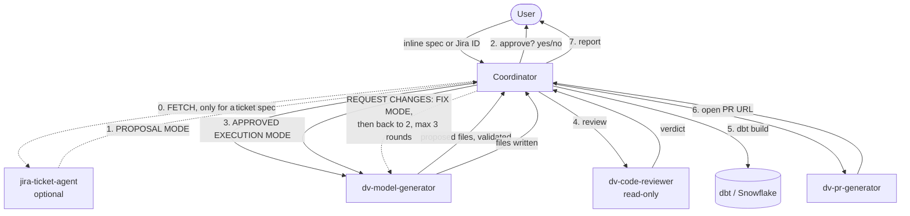

# Data Vault Agent: ticket → reviewed, tested pull request

A set of cooperating AI agents (GitHub Copilot custom agents in VS Code) that take a ticket and produce a **reviewed, dbt-tested pull request** of Data Vault 2.0 models on Snowflake. Humans supply the ticket and approve every set of files before it is written; the agents do the rest.

> The Data Vault use case is the example. The agent pattern (coordinator → generator → reviewer → build → PR, with human gates) is reusable for any ticket-driven engineering work. See [Reusing this pattern](#9-reusing-this-pattern-for-other-work).

---

## 1. What it does in one minute

You give the **Coordinator** a ticket, either typed inline or as a Jira ID:

```text
Ticket: DV-101
Source table: RAW_CORE_BANKING.BRANCHES
Hub: hub_branch   (BK: BRANCH_CODE, HK = hash of BRANCH_CODE + BKCC)
Grain columns: BRANCH_CODE
Satellite: sat_branch_details   (columns: BRANCH_NAME, CITY)
```

The Coordinator runs the whole flow. It is the only agent that calls other agents:

0. **Ticket input:** uses your inline spec, or asks the optional Jira agent to read the ticket.
1. **Proposal:** the generator builds a staging model, a Hub/Link and optionally a Satellite with YAML tests. It follows `DV_STANDARD.MD` and the **live** Snowflake schema, and checks every SQL file with a rule-based validator (no AI involved). Nothing is written yet.
2. **Your approval:** you answer yes or no to the proposed files.
3. **Write files:** the generator writes exactly what you approved, on branch `<TICKET_ID>_DEV`.
4. **Review:** a separate, read-only reviewer agent audits the files. Findings go back through the generator and to you again, for at most 3 rounds.
5. **dbt build:** the Coordinator builds and tests the new models.
6. **PR:** the PR agent commits only the approved files and opens the PR.
7. **Report:** you get the branch, files, verdict, dbt result and PR URL.

---

## 2. Repository map

```
.
├── .github/agents/                         ← the agents (plain Markdown, edit to change behaviour)
│   ├── Data_Vault_Pipeline_Coordinator.agent.md   Orchestrator: runs the steps in order, owns approvals
│   ├── dv-model-generator.agent.md                Builds + validates the models, writes after approval
│   ├── dv-code-reviewer.agent.md                  Read-only auditor: APPROVE / REQUEST CHANGES
│   ├── dv-pr-generator.agent.md                   Stages approved files, commits, pushes, opens the PR
│   ├── jira-ticket-agent.agent.md                 OPTIONAL: Jira fetch / comment / status
│   └── DV_STANDARD.MD                             The rulebook and SQL/YAML templates all agents follow
│
├── mcp_servers/                            ← the tools the agents call (one file per area)
│   ├── mcp_base.py              Shared MCP plumbing (stdio JSON-RPC loop), used by every server below
│   ├── snowflake_mcp.py         sql_exec_tool                          → Snowflake
│   ├── dv_validator_mcp.py      validate_model_tool                    → rule-based SQL checks
│   ├── workspace_mcp.py         read_file_tool, run_commands, execute_git_pr → local files / git / gh
│   └── jira_mcp.py              fetch_jira_ticket, add_jira_comment, update_jira_status → Jira (OPTIONAL)
│
├── .vscode/mcp.json                        Registers the four MCP servers with VS Code
├── dv_gen_project/                         dbt project where generated models land (see its README)
└── .env.example                            Template for credentials, copied to .env (git-ignored)
```

---

## 3. Agents and the tools they use

| Agent | Job | Tools (MCP server → tool) | Can write files? |
|---|---|---|---|
| **Data_Vault_Pipeline_Coordinator** | Runs the pipeline in order, asks for approvals, reads verdicts, runs `dbt build` | `agent` (dispatch sub-agents), terminal | No |
| **dv-model-generator** | Three modes: PROPOSAL (generate + validate, no writes), APPROVED EXECUTION (create branch, write the approved files), FIX (apply reviewer findings, no writes) | `snowflake-mcp/sql_exec_tool`, `dv-validator-mcp/validate_model_tool`, `workspace-mcp/read_file_tool`, edit, terminal (git branch) | Yes, after approval only |
| **dv-code-reviewer** | Audits the written files against the standard and returns a verdict | `workspace-mcp/read_file_tool` | **No** (read-only by design) |
| **dv-pr-generator** | Stages exactly the approved files, commits, pushes, opens the PR | terminal (`git`, `gh`), edit (PR body file) | Git + a temporary `pr_body.md` (git-ignored) |
| **jira-ticket-agent** *(optional)* | Turns a Jira ticket into a ticket spec; posts comments; changes status | `jira-mcp/*` | No |

**Why one MCP server per area?** Each file is small and has one job, so you can see at a glance what touches Snowflake, Jira, or git. A team without Jira simply doesn't start `jira-mcp`. Each server starts once when VS Code opens, so there is no extra cost per tool call.

---

## 4. The flow

The Coordinator is the hub. Every arrow goes to or from it, and sub-agents never call each other. Step numbers match the Coordinator's instructions in [Data_Vault_Pipeline_Coordinator.agent.md](.github/agents/Data_Vault_Pipeline_Coordinator.agent.md).



### Steps and handoffs

| Step | Coordinator dispatches | What it passes | What must come back to continue | Otherwise |
|---|---|---|---|---|
| **0. Ticket input** | `jira-ticket-agent` FETCH *(only if you gave just a Jira ID)* | Ticket ID | `TICKET SPECIFICATION` with `MISSING: none` | Stop and ask you for the missing values |
| **1. Proposal** | `dv-model-generator`, PROPOSAL MODE | Ticket spec | Proposed files, every SQL file `pass: true`. **Nothing written.** | Stop: table, `sources.yml` entry or `REF_SOURCE_SYSTEM` row missing; ticket REC_SRC/BKCC differs from `REF_SOURCE_SYSTEM`; ticket conflicts with the standard; or validation still failing after 3 fix attempts |
| **2. Approval** | *you* | Proposed files | `yes` | `no` ends the run |
| **3. Write files** | `dv-model-generator`, APPROVED EXECUTION MODE, `CORRECTED: false` | Exact approved proposal | Branch `<TICKET_ID>_DEV` created from fresh `main`, all files written | Stop: workspace not clean, branch already exists, file not created |
| **4. Review** | `dv-code-reviewer` | All approved file paths, ticket requirements | `VERDICT: APPROVE` | `REQUEST CHANGES`: generator FIX MODE (full findings, spec, current files) → you approve again → write with `CORRECTED: true` on the same branch → review all files again. **Max 3 review rounds**, then stop with the remaining findings. |
| **5. dbt build** | *(Coordinator runs it)* | `dbt build --select <all generated models>` | `DBT_EXIT=0` | Stop and show the dbt errors; you decide what to do next |
| **6. PR** | `dv-pr-generator` | Files, ticket ID, your approval, reviewer verdict, dbt result | Real PR URL | Stop on any failed git or `gh` command (no auto-retry) |
| **7. Report** | *you* | Branch, files, verdict, dbt result, PR URL | — | — |

### Rules that keep it predictable

- **The Coordinator owns the flow.** Sub-agents do one job and return to it. They never call each other.
- **What you approve is exactly what gets written.** Any change after approval (for example a reviewer fix) needs a new approval.
- **Every loop has a limit.** The validator gets at most 3 fix attempts per model, and review gets at most 3 rounds. Nothing can cycle forever.
- **Any failure stops the run and is reported.** Agents never guess, retry blindly or skip a step.

### If a run stops after files were written

When a run ends after Step 3 (you said no, the review limit was reached, dbt failed, or git failed), the generated files stay on `<TICKET_ID>_DEV`. A new run for the same ticket stops at Step 3 because the branch exists and the workspace isn't clean. You have two options:

- **Finish by hand:** fix the problem on `<TICKET_ID>_DEV` yourself and open the PR manually.
- **Start over:** discard everything from that run. **This deletes the generated files.** The Coordinator never does this for you.

  ```bash
  git checkout -- .                             # undo edits to tracked files (e.g. sources.yml)
  git clean -fd -- dv_gen_project/models        # delete the new, uncommitted model files
  git checkout main
  git branch -D <TICKET_ID>_DEV                 # delete the local branch
  git push origin --delete <TICKET_ID>_DEV      # only if the branch was already pushed (failure at PR creation)
  ```

  Then run the ticket again.

---

## 5. How it connects to Snowflake

```
.env  ──►  mcp_servers/snowflake_mcp.py  ──►  sql_exec_tool  ──►  dv-model-generator
                (snowflake-connector-python, password auth, one reused connection)

~/.dbt/profiles.yml  ──►  dbt build  (run by the Coordinator from dv_gen_project/)
```

- **Credentials:** `SNOWFLAKE_ACCOUNT`, `SNOWFLAKE_USER`, `SNOWFLAKE_PASSWORD`, plus optional `SNOWFLAKE_WAREHOUSE` / `SNOWFLAKE_DATABASE` / `SNOWFLAKE_SCHEMA` (defaults: `COMPUTE_WH` / `CUSTOM_AGENT` / `STAGING`). The connection opens on the first query and is reused.
- **What the agent queries** (read-only lookups, scoped to the ticket's table):
  - `INFORMATION_SCHEMA.COLUMNS`: the live column list of the source table.
  - `CUSTOM_AGENT.CONTROL.REF_SOURCE_SYSTEM`: the governed `REC_SRC` / `BKCC` for that table. Agents never insert or edit rows here.
- **Objects that must exist:** raw source schemas (e.g. `RAW_CORE_BANKING`, `RAW_CARD_PROCESSOR`), `CONTROL.REF_SOURCE_SYSTEM`, and the target schemas `STAGING`, `RAW_VAULT`, `INFO_MART`.
- **dbt** uses its own profile named `dv_gen_project` in `~/.dbt/profiles.yml`. It routes staging models to views in `STAGING`, Hubs, Links and Satellites to incremental tables in `RAW_VAULT`, and marts to views in `INFO_MART`.
- **Security:** `sql_exec_tool` can run any SQL. Give the agent's Snowflake user a least-privilege role, and prefer key-pair or SSO over a password for shared use.

---

## 6. How it connects to Jira (optional)

Jira is a **separate, optional agent**. The pipeline works fully without it: paste the ticket spec inline instead.

```
.env (JIRA_*)  ──►  mcp_servers/jira_mcp.py  ──►  jira-ticket-agent  ──►  (Coordinator, Step 0)
                     Jira Cloud REST API v2, basic auth with email + API token
```

**Enable it:**

1. Create an API token at <https://id.atlassian.com/manage-profile/security/api-tokens>.
2. Add to `.env`: `JIRA_DOMAIN=https://<your-company>.atlassian.net`, `JIRA_EMAIL=…`, `JIRA_API_TOKEN=…`.
3. Start `jira-mcp` from the VS Code MCP panel.

**What it can do:**

| You say (to `jira-ticket-agent`, or to the Coordinator with just an ID) | Mode | Jira call |
|---|---|---|
| `Run pipeline for DLJ25-410` (Coordinator) | FETCH | Reads summary + description and extracts the ticket spec. Missing fields are listed, never guessed. |
| `Add a comment to DLJ25-410: started working on this` | COMMENT | Posts the comment and returns its ID |
| `Move DLJ25-410 to In Progress` | STATUS | Transitions the ticket; if not allowed, lists the valid statuses |

**For the FETCH to work,** write the ticket description with the same fields as an inline spec: source table, Hub/Link name, BK, HK formula, grain columns, and Satellite columns if a Satellite is wanted. Anything missing is reported back and the run stops.

---

## 7. Setup

**Prerequisites:** VS Code with GitHub Copilot (agent mode / custom agents) · [`uv`](https://docs.astral.sh/uv/) · Python ≥ 3.10 · `dbt-core` + `dbt-snowflake` · GitHub CLI `gh` (logged in with `gh auth login`) · Snowflake access.

1. `cp .env.example .env` and fill in the Snowflake values (and the Jira ones if you want Jira).
2. Create a `dv_gen_project` profile in `~/.dbt/profiles.yml`, then:
   ```bash
   cd dv_gen_project
   dbt deps
   dbt debug
   ```
3. **Open this folder as the VS Code workspace root.** `.github/agents/` and `.vscode/mcp.json` are found relative to the opened folder. This matters when the project sits inside a monorepo: open this subfolder, not the monorepo root.
4. In the MCP panel, start `snowflake-mcp`, `dv-validator-mcp`, `workspace-mcp` and, optionally, `jira-mcp`. Each server installs its own Python dependencies through `uv` on first run.

**Quick check that a server works:**

```bash
printf '{"jsonrpc":"2.0","id":1,"method":"tools/list"}\n' | uv run mcp_servers/dv_validator_mcp.py
```

---

## 8. Guardrails

| Guardrail | How |
|---|---|
| Nothing written without consent | The generator writes only in APPROVED EXECUTION MODE, after your "yes" |
| Independent review | The reviewer has only a read tool |
| Human approval | Before files are written, and again before every reviewer-driven change is written |
| Grounded in reality | Live schema fetch is mandatory; missing table, source or metadata stops the run |
| No invented metadata | `REC_SRC` / `BKCC` always come from `REF_SOURCE_SYSTEM` (ticket values are only cross-checked); agents never write to it |
| Deterministic checks first | `validate_model_tool` must pass before you see any SQL |
| Fail-stop | Failed dbt, git or `gh` commands halt the run; no automatic retries |
| No endless loops | Max 3 validator fix attempts per model, max 3 review rounds |
| Single orchestrator | Only the Coordinator dispatches agents; sub-agents always return to it |
| Safe git | Ticket branch `<TICKET_ID>_DEV`, never push to `main`, stage only the approved files (never `git add -A`) |
| Secrets stay local | `.env` is git-ignored; `.env.example` holds only key names |

---

## 9. Reusing this pattern for other work

The structure is generic. Only the domain content is Data Vault specific.

| Keep as-is | Replace for your use case |
|---|---|
| Coordinator / generator / reviewer / PR roles and the handoff table above | `DV_STANDARD.MD` → your team's standard and templates |
| Proposal → approve → write → review → build → PR sequence | `dv_validator_mcp.py` → your deterministic checks |
| Human gates, fail-stop rules, safe git | The reviewer's checklist |
| `mcp_base.py`, `workspace_mcp.py`, `jira_mcp.py` | `snowflake_mcp.py` → your database or API |
| Optional Jira agent for ticket intake | `dbt build` → your build or test command |

**Examples:** dbt staging or mart scaffolding, test generation, Terraform or IaC changes, API endpoint scaffolding, documentation updates.

**What this gives the team:**
- Faster ticket-to-PR delivery.
- The same output whoever runs it.
- Standards enforced on every run instead of living in people's heads.
- Defects caught at four layers: validator → reviewer → dbt → human.
- Review time spent on business logic, not formatting.

---

## 10. Status and known items

| Component | Status |
|---|---|
| Coordinator, generator, reviewer, PR agent | Implemented |
| Optional Jira agent (fetch / comment / status) | Implemented |
| MCP servers (Snowflake, validator, workspace, Jira) | Implemented |
| Staging, Hub, Satellite generation with tests | Implemented and used on demo tickets |
| Link and mart generation | Supported by the standard and dbt config; not exercised yet |

**Known items:**

- The standard refers to `ref_business_key_collision`; the implementation uses `CONTROL.REF_SOURCE_SYSTEM`. These should be aligned.
- Roadmap ideas:
  - CI that runs the validator and `dbt build` on every PR.
  - A Jira comment with the PR URL when a run finishes.
  - Metrics on cycle time and on review findings.
